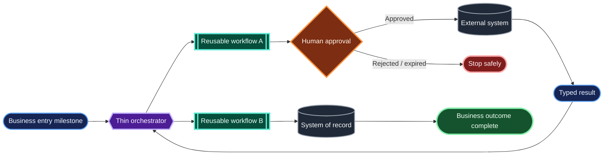
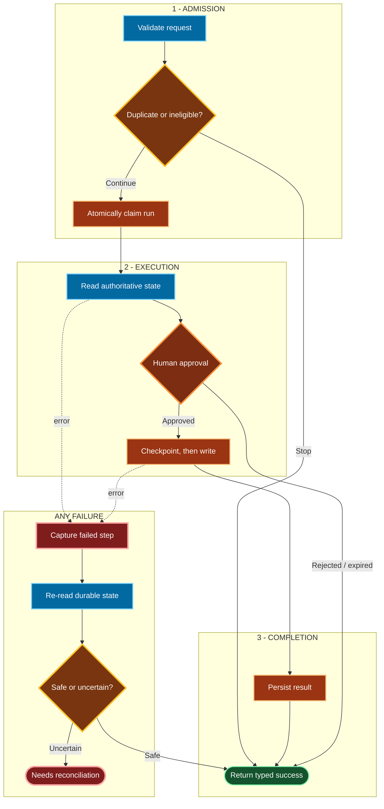

# Mermaid diagrams for SYSTEM.md

Read this reference when a `SYSTEM.md` explanation needs a complex Mermaid
diagram, a new visual grammar, or paired overview/detail views. For a small
diagram, the invariants in `SKILL.md` are enough.

## Start with the reader's question

Decide what the diagram must let a reader answer before extracting nodes. Useful
questions include:

- What is the complete business journey?
- Which component or workflow owns each stage?
- Where do people or rules make decisions?
- Which systems hold durable state?
- What happens after rejection, expiry, duplication, or an uncertain write?
- Where can an operator safely resume?

One diagram gets one primary question. Draft the business sequence in plain text
first, then include only the actors, systems, workflows, states, decisions, and
failure outcomes needed to answer it. Derive those facts from the surrounding
documentation and implementation; do not invent missing behavior to complete a
visual.

## Choose the smallest useful zoom

| View | Use it to show | Intentionally omit |
|---|---|---|
| High-level overview | business milestones, ownership boundaries, reusable workflows, human decisions, external systems, terminal outcomes | API calls, helper steps, checkpoints, retries, and reconciliation internals |
| Detailed trace | validation, duplicate/idempotency checks, exact decision boundaries, durable reads and writes, returned states, failure and recovery paths | unrelated implementation ceremony and internal nodes with no explanatory value |

Do not create both views by default. Pair them only when the overview would
otherwise become crowded or when the detailed safety behavior is independently
important. A stage shown in the overview must be recognizable in the detailed
trace by the same name, lane, or domain color.

## Visual grammar

Keep each channel stable:

- **Shape:** what kind of thing the node is.
- **Color:** which domain, role, or state it represents.
- **Position:** sequence, phase, and ownership.
- **Line style:** primary execution, supporting dependency, return, or failure.

### Shapes

| Shape | Mermaid syntax | Meaning |
|---|---|---|
| Rounded milestone | `A(["Milestone"])` | event, entry state, returned state, or terminal outcome |
| Reusable workflow | `A[["Workflow"]]` | independently meaningful workflow or subworkflow with a contract |
| Orchestrator/control | `A{{"Orchestrator"}}` | router, coordinator, or control boundary |
| Decision | `A{"Approved?"}` | human or deterministic branch with named outcomes |
| External system/store | `A[("System of record")]` | provider, queue, system of record, or durable external service |
| Operation | `A["Validate request"]` | read, write, verification, or transformation step |
| Safe stop | `A(["Needs reconciliation"])` | explicit stopped state with no unsafe downstream write |

Do not change a shape's meaning between diagrams. Color or a clear label may
distinguish a human decision from a deterministic decision, but both remain
decision shapes.

### Color strategies

Use the repository's established palette when one exists. Otherwise choose one
of these strategies per diagram:

- **Domain colors** distinguish product areas or reusable workflows across a
  high-level journey.
- **Operation colors** distinguish reads, writes, control, decisions, and
  outcomes inside a detailed reliability trace.

Do not mix the two strategies unless the legend makes both dimensions
unambiguous. Use the smallest palette that materially improves tracing.

The following dark-mode-friendly colors are an optional starting point, not a
project-wide requirement:

| Semantic class | Fill | Stroke | Text |
|---|---|---|---|
| `stage` / input | `#172554` | `#60a5fa` | `#eff6ff` |
| `workflow` | `#064e3b` | `#5eead4` | `#ecfdf5` |
| `control` | `#4c1d95` | `#c4b5fd` | `#faf5ff` |
| `human` | `#7c2d12` | `#fb923c` | `#fff7ed` |
| `decision` | `#78350f` | `#fbbf24` | `#fffbeb` |
| `read` | `#0369a1` | `#7dd3fc` | `#ffffff` |
| `write` | `#9a3412` | `#fdba74` | `#ffffff` |
| `external` | `#1f2937` | `#9ca3af` | `#f9fafb` |
| `success` | `#14532d` | `#86efac` | `#f0fdf4` |
| `danger` | `#7f1d1d` | `#fca5a5` | `#fef2f2` |
| `muted` | `#475569` | `#cbd5e1` | `#ffffff` |

Use semantic class names such as `workflow`, `decision`, `write`, and `danger`,
not decorative names such as `blue1` or `box3`. Use `stroke-width:2px` for
ordinary nodes and `3px` for decisions, reusable workflows, human approvals, or
states deserving attention. Reserve `4px` for one genuinely central path.

## Layout, lanes, and edges

Use `flowchart LR` for a short chronological journey or high-level handoff. Use
`flowchart TB` for a detailed workflow with branches, phases, and recovery lanes.
Keep one dominant direction. If the visual is too wide, split it by phase rather
than shrinking its text.

Use `subgraph` lanes when phase or ownership matters more than individual nodes.
Good lanes include reusable workflows, business phases, system boundaries, and
one cross-cutting failure/recovery lane. Prefer two or three meaningful lanes to
deeply nested boxes.

- Use solid arrows for the primary sequence.
- Label decision edges with business outcomes such as `Approved`, `Existing
  result`, `Rejected / expired`, `Safe`, or `Uncertain` rather than unexplained
  booleans.
- Use dotted arrows for dependencies, reuse, or error paths that are not the
  normal execution sequence.
- When a child workflow returns, show a named or typed returned state instead of
  an ambiguous backward arrow.
- Consolidate repeated error edges into one recovery lane when they share a
  recovery contract.

## Labels and surrounding prose

Write short, concrete, business-readable labels. Prefer verb plus object:
`Validate billing request`, `Verify exact name and email`, or `Checkpoint draft
IDs`. Use exact status names when they are durable contracts. Name external
systems directly and describe human actions from the person's point of view.
Keep paragraphs outside nodes.

Introduce the diagram with its primary question and what this zoom level omits.
After it, explain what to notice first, decode any visual grammar that is not
already established, and point to the next level of detail. A one-sentence trace
is often enough, for example: “Teal marks reusable workflows, amber marks
decisions, gray marks durable systems, and green/red mark terminal outcomes.”

## Generic high-level template

Adapt names and classes to the project's actual vocabulary and visual grammar.

## Generic detailed-workflow template

## Validation and review

Validate Mermaid in the actual documentation target because supported syntax and
versions vary. Use ASCII characters in node IDs; human-facing labels may contain
punctuation and intentional ` ` breaks. Inspect at default page width and in
the target theme when practical. If no renderer is available, review the syntax
and tell the user that rendered output was not verified.

Before finishing, confirm:

- The diagram answers one clear question and has the right zoom level.
- Shape and color have separate, consistent meanings.
- Meaning does not depend on color alone.
- A legend or short visual trace explains a newly introduced grammar.
- The main path is visually dominant.
- Ownership boundaries, reusable workflows, decisions, and external systems are
  distinguishable when relevant.
- Meaningful branch edges use business labels.
- Material rejected, expired, duplicate, stopped, and reconciliation outcomes
  are visible when they affect the documented contract.
- Detailed reliability diagrams distinguish durable reads and writes.
- The layout has one dominant direction, few crossing edges, and readable text.
- The diagram agrees with the prose, implementation, and any other zoom level.
- The visual renders in the target environment, or lack of render verification
  is disclosed.

If a visual fails several checks, simplify or split it. Do not add color or more
containers to compensate for a diagram that is answering too many questions.
